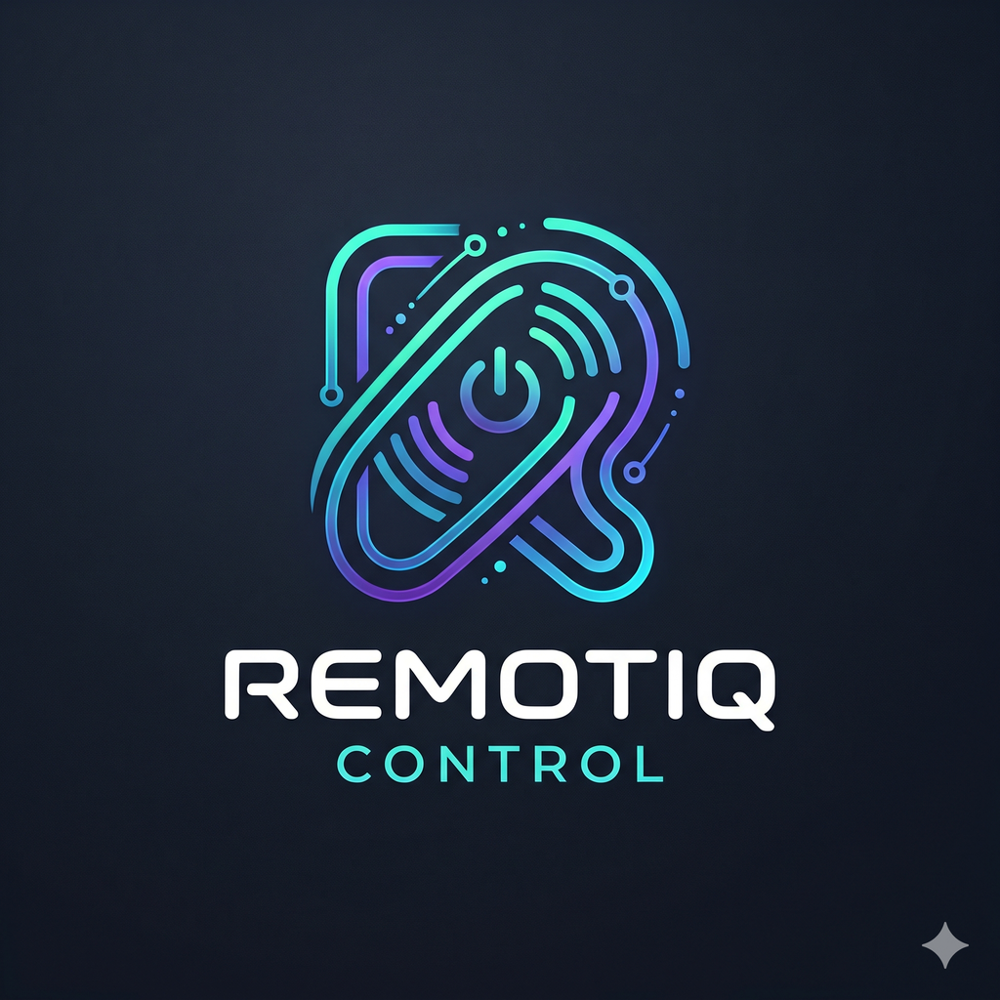

<p align="center">
  
</p>

<h1 align="center">DroidLink</h1>
<p align="center"><b>Consent-based remote viewing, control and file transfer between your own Android devices.</b></p>

<p align="center">
  <a href="https://github.com/hgcheat094-max/DroidLink/actions/workflows/android-build.yml"></a>
  <a href="https://github.com/hgcheat094-max/DroidLink/actions/workflows/backend-tests.yml"></a>
  
  
  
  
  
</p>

---

## What is DroidLink?

DroidLink lets you **see and operate your own Android phone or tablet from another Android device** - for example to help a relative, use a spare phone as a remote screen, or manage a device that is out of reach. It is built to be **transparent**: nothing happens without the device owner's approval, a notification and in-app banner are shown the whole time, and one tap disconnects everything.

> DroidLink is for devices **you own or are explicitly authorised to manage**. It has no stealth mode, no hidden recording, no keylogging and no permission bypasses - by design and by policy (see [SECURITY.md](SECURITY.md)).

## Verification status (please read)

| Part | State |
|------|-------|
| FastAPI relay: auth, pairing, sessions, relay policy, rate limiting (35 service-level tests) | Run and passing when this project was generated |
| FastAPI HTTP/WebSocket tests (`backend/tests/test_api.py`) | Written; run them with `pip install -r requirements-dev.txt && pytest` |
| Android app (61 Kotlin files, Gradle config, unit tests) | **Written but not compiled in the generation environment** (no Android SDK / network there). Only structural checks ran (`scripts/check_kotlin_static.py`). Expect to fix a few compile errors on the first build, and run the test-suite yourself. CI in `.github/workflows` will tell you immediately. |
| On-device behaviour (MediaProjection, AccessibilityService, SAF) | Not tested on hardware yet |

Nothing in this repository claims a release is ready; the release workflow refuses to publish unless tests pass.

## Features

| Area | What you get |
|------|--------------|
| **Secure pairing** | 8-character single-use codes (2 min expiry) or QR; manual entry; owner must approve every pairing; revoke from either side; per-device permissions |
| **Remote screen** | MediaProjection capture with Android's official consent, JPEG stream over WebSocket, adaptive quality / frame rate under congestion, rotation support, adjustable fps / quality / resolution, persistent notification |
| **Remote touch** | Tap, double-tap, long-press, swipe, scroll, Back / Home / Recents / Notifications via AccessibilityService (`dispatchGesture`) |
| **Remote keyboard** | Text into the focused field, Backspace, Enter, select-all, copy / cut / paste, next / previous field. Password fields are blocked. |
| **App navigation** | List launchable apps, open one with a launch intent, switch apps through Recents |
| **File transfer** | Both directions, Storage Access Framework only, accept / decline per file, progress, cancel, SHA-256 integrity check, history |
| **Device dashboard** | Model, Android version, battery + charging, storage, RAM, resolution, network, app version, connection state |
| **Safety** | Emergency *Disconnect now* (app banner + notification action), pause control, session time limit, biometric / screen-lock confirmation before approving, DroidLink's own screens cannot be remotely controlled |
| **Backend** | FastAPI relay, JWT access tokens (15 min), hashed device secrets, per-route and global rate limits, audit log, OpenAPI docs at `/docs` |
| **UI** | Material 3, light / dark, splash, onboarding, 13+ screens, empty / error / loading states, animations |

## Screenshots

Screenshots are not generated automatically. After your first build, capture them on a device and place them in `docs/screenshots/` (see [docs/screenshots/README.md](docs/screenshots/README.md)), then reference them here:

<!--  -->

## Technology stack

Kotlin 2.0 | Jetpack Compose + Material 3 | MVVM + Clean Architecture | Room | DataStore | OkHttp WebSocket + REST | kotlinx.serialization | Android Keystore (AES-256-GCM) | BiometricPrompt | ZXing | Gradle Kotlin DSL (version catalog) | Python 3.11+ FastAPI, SQLite, PyJWT | GitHub Actions

## Architecture overview

```
┌────────────── Controller phone ─────────────┐        ┌──────────── Target phone (being viewed) ───────────┐
│ Compose UI → ViewerViewModel                │        │ Compose UI (approval, banner, emergency stop)      │
│   SessionSocket ──────────────┐             │        │   HostSessionService (foreground, persistent notif)│
└───────────────────────────────┼─────────────┘        │     ScreenCaptureEngine ← MediaProjection consent  │
                                │  WSS (TLS)           │     RemoteInputExecutor → AccessibilityService     │
                       ┌────────▼─────────┐            │     FileTransferManager (SAF)                      │
                       │  FastAPI relay   │◄───────────┤     SessionGuard (scope + expiry gate)             │
                       │ auth · pairing · │   WSS      └────────────────────────────────────────────────────┘
                       │ sessions · policy│
                       └──────────────────┘
```

Layers inside the app (`com.droidlink`): `presentation` (Compose, ViewModels) → `domain` (models, repository interfaces, use cases) ← `data` (Room, repositories) · `network` (REST, WebSocket, protocol) · `security` (Keystore, validation, session guard, re-auth) · `services` (capture, input, files, foreground service). Details: [docs/ARCHITECTURE.md](docs/ARCHITECTURE.md).

## Installation

### Android app

1. Install Android Studio (Ladybug or newer) with JDK 17 and Android SDK 35.
2. `git clone https://github.com/hgcheat094-max/DroidLink.git` and **File → Open** the `DroidLink` folder.
3. Let Gradle sync. (The Gradle wrapper *JAR* is a binary and is not included: Android Studio downloads Gradle 8.9 itself from `gradle/wrapper/gradle-wrapper.properties`. For command-line builds run `scripts/bootstrap-wrapper.sh` once, or use a local `gradle` 8.9.)
4. Run on a device / emulator (API 26+).

Command line:

```bash
gradle :app:assembleDebug          # app/build/outputs/apk/debug/
gradle :app:testDebugUnitTest      # unit tests
gradle :app:lintDebug
```

Debug builds default to `http://10.0.2.2:8000` (the host machine from the Android emulator). Release builds only accept `https://`.

### Relay server (backend)

```bash
cd backend
python -m venv .venv && . .venv/bin/activate
pip install -r requirements.txt
export DROIDLINK_SECRET_KEY="$(python -c 'import secrets;print(secrets.token_urlsafe(48))')"
uvicorn app.main:app --host 0.0.0.0 --port 8000
```

Open `http://localhost:8000/docs` for the interactive OpenAPI / Swagger UI. For real use put TLS in front (Caddy / nginx / `uvicorn --ssl-keyfile`). See [backend/README.md](backend/README.md) and [docs/INSTALLATION.md](docs/INSTALLATION.md).

### First connection

1. On **both** phones: open DroidLink → enter the relay address → *Register*.
2. On the phone to be viewed (**target**): *Pair a device → Show my code*.
3. On the other phone (**controller**): *Pair a device → Enter a code / Scan QR*.
4. Target: approve the pairing. Controller: *My devices → Connect*, choose permissions.
5. Target: approve the session (confirm fingerprint / screen lock, then Android's screen-capture prompt).
6. For touch / keyboard control the target owner must switch on **DroidLink Remote Control** in *Settings → Accessibility*.

## What Android does *not* allow (and what DroidLink does instead)

| Limitation | Behaviour |
|-----------|-----------|
| Screen capture needs a fresh user consent for every session (Android 14+: single use) | Consent dialog is shown each time; DroidLink never reuses or skips it |
| `FLAG_SECURE` windows (banking apps, DRM video, DroidLink itself) are black in captures | Shown black; documented |
| Accessibility gestures cannot touch some system dialogs / secure windows | Action fails; the controller sees a friendly message |
| Apps cannot read other apps' clipboards in the background (Android 10+) | Copy / paste run on the target's clipboard; DroidLink never reads clipboard content |
| Starting activities from the background can be blocked | Open-app reports an error if Android refuses |
| Background execution limits | The target must have DroidLink open to *receive* a new request; an approved session keeps running as a foreground service |
| Google Play restricts apps that use the Accessibility API for remote control | Distribute through GitHub / F-Droid, or read Play's policy before publishing |

## API documentation

Interactive: `/docs` (Swagger) and `/redoc` on your server. Summary and message formats: [docs/API.md](docs/API.md).

## Security

Short version: TLS everywhere, device secrets only in the Android Keystore, 15-minute tokens in memory, hashed secrets on the server, single-use short-lived codes, explicit approval for pairing *and* each session, scope enforcement on the phone **and** on the relay, rate limiting, audit log. Honest limits (e.g. the relay can see session traffic - no end-to-end encryption yet) are listed in [docs/SECURITY.md](docs/SECURITY.md). Report vulnerabilities privately: [SECURITY.md](SECURITY.md).

## Contributing

See [CONTRIBUTING.md](CONTRIBUTING.md) and the [Code of Conduct](CODE_OF_CONDUCT.md). Every feature must keep the device owner in control.

## Roadmap

- [ ] End-to-end encrypted sessions (X25519 key agreement through the pairing, relay sees ciphertext only)
- [ ] Hardware H.264 streaming (MediaCodec) for lower bandwidth than JPEG
- [ ] Push notifications (FCM / UnifiedPush) so a sleeping target can receive requests
- [ ] Certificate pinning option and relay TLS setup guide for self-hosters
- [ ] Session auto-resume after short network drops
- [ ] Redis-backed rate limiting and multi-instance relay
- [ ] Instrumented (device) tests and Compose UI tests
- [ ] Localisation

## Credits & contact

Built by **Yogesh** - Telegram [@YogeshBhai729](https://t.me/YogeshBhai729) - GitHub [hgcheat094-max](https://github.com/hgcheat094-max).

## License

[MIT](LICENSE)
